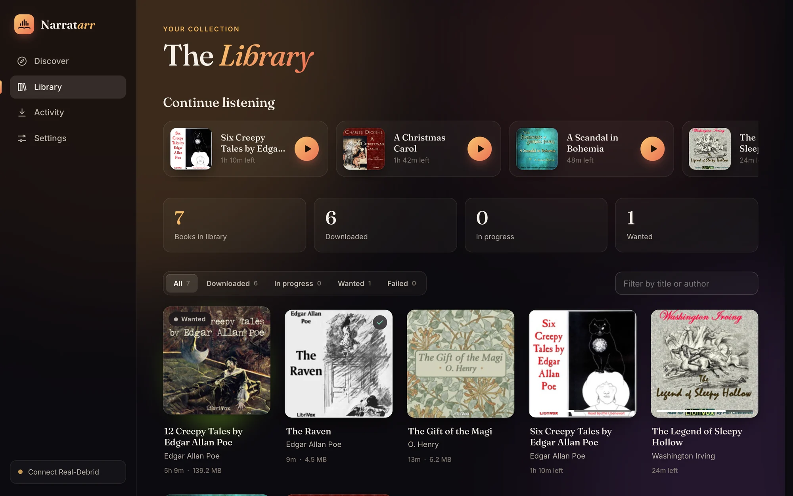
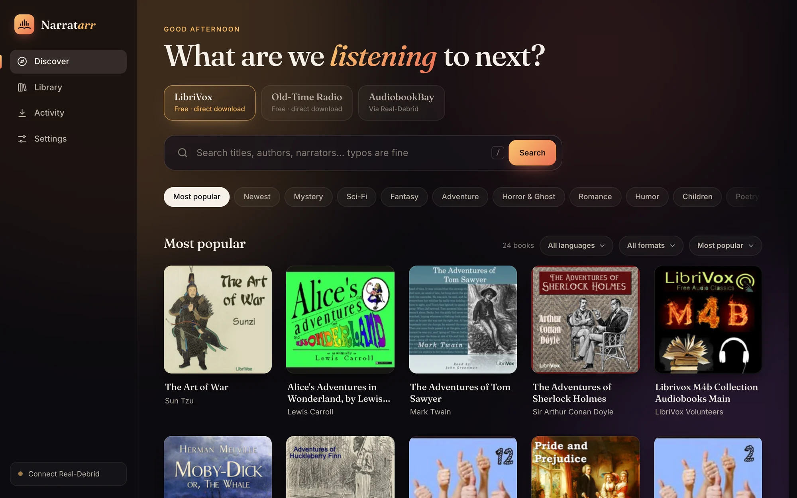
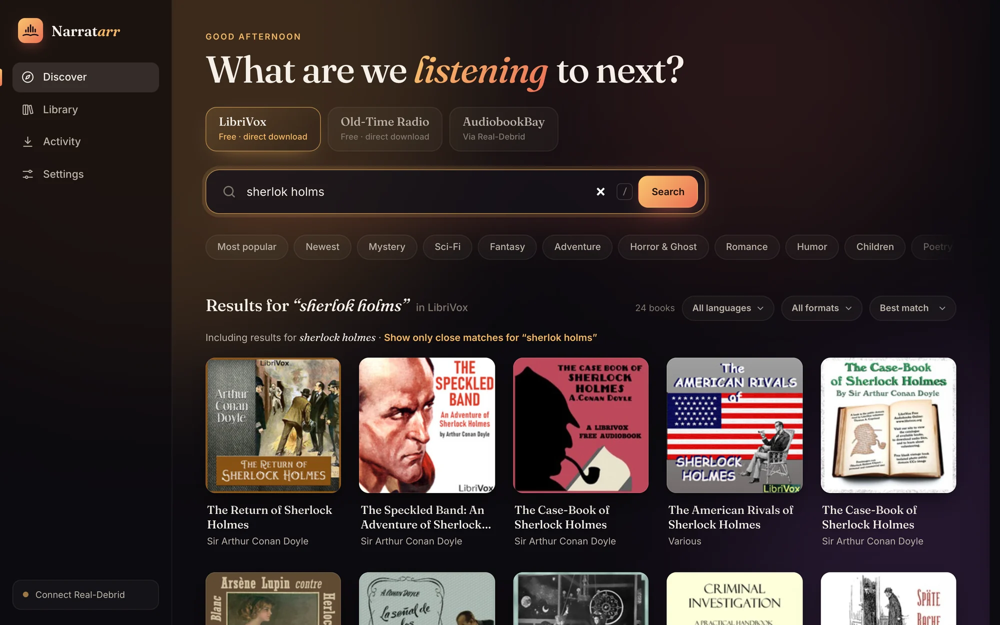
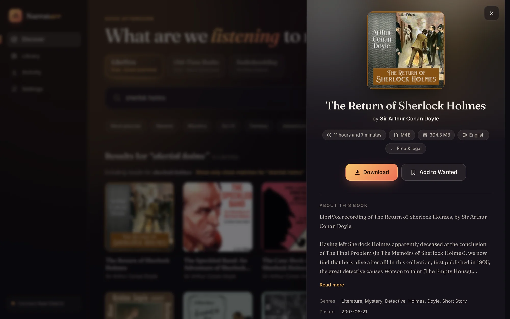
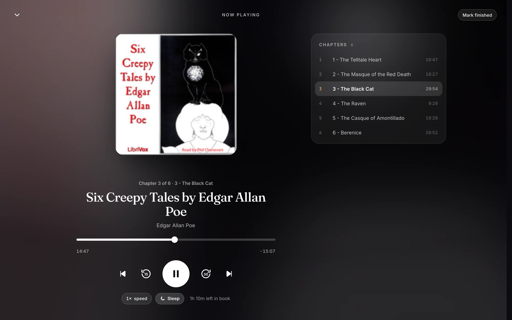
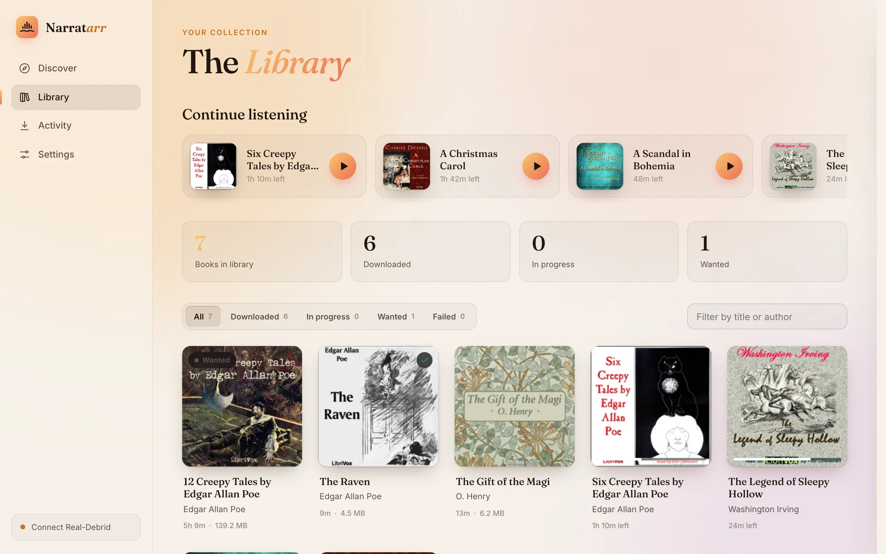
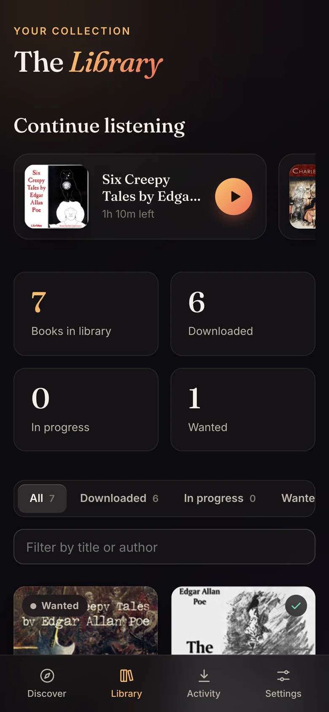
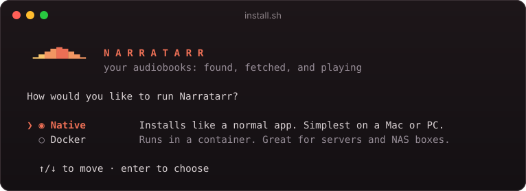
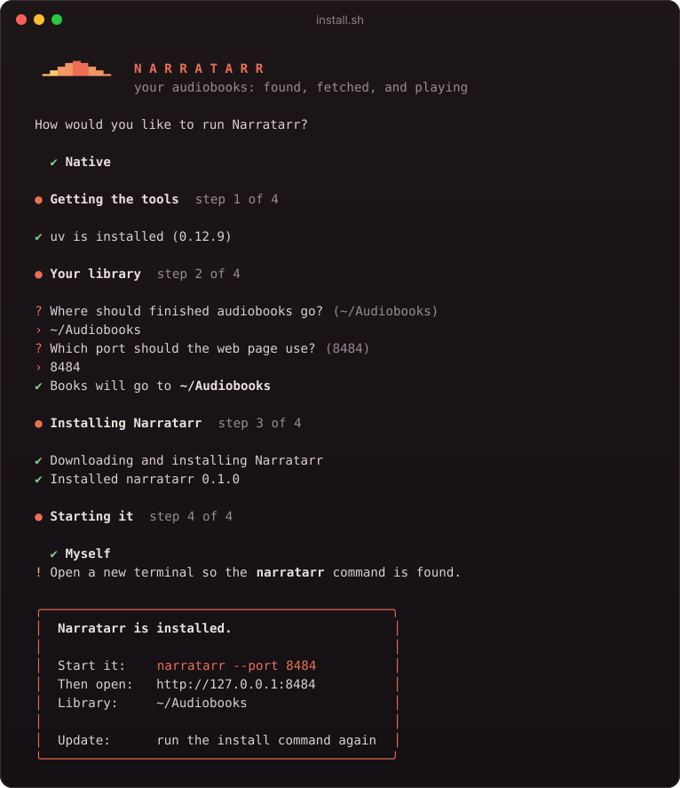
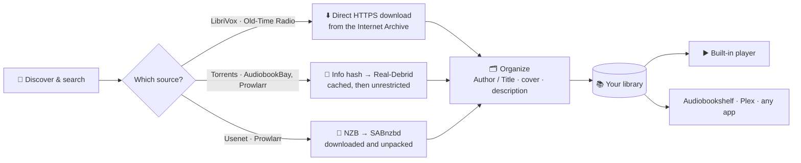

<div align="center">


# Narratarr

**Your audiobooks: found, fetched, and playing.**

An \*arr-style audiobook manager with a built-in player.<br>
Discover a book, click once, and it lands in your library, tagged, organized and ready to listen to.

[](https://github.com/narratarr/narratarr/actions/workflows/ci.yml)
[](https://github.com/narratarr/narratarr/pkgs/container/narratarr)
[](pyproject.toml)
[](LICENSE)

[**Install**](#-install) · [**Features**](#-features) · [**How it works**](#-how-it-works) · [**Configuration**](#%EF%B8%8F-configuration) · [**FAQ**](#-faq)

<br>



</div>

<br>

## ✨ Features

<table>
<tr>
<td width="50%" valign="top">

### Discover
Browse more than 30,000 free, legal audiobooks and radio shows from **LibriVox** and **Old-Time Radio**. You can explore by genre, see what's most popular or newest, and filter by language and format.

</td>
<td width="50%" valign="top">

### Search that forgives typos
Search for `sherlok holms` and you still get Sherlock Holmes. Titles suggest themselves as you type, results are ranked by how well they match, and there's always a way back to your exact words.

</td>
</tr>
<tr>
<td></td>
<td></td>
</tr>
<tr>
<td width="50%" valign="top">

### One click to your library
Every book shows its length, format, size and description before you commit. Downloads are queued, tracked live on the **Activity** page, and filed into your library as `Author/Title`, with cover art and description included.

</td>
<td width="50%" valign="top">

### A real player, built in
No other app needed. You get chapters (including the chapter markers inside `.m4b` files), speeds from 0.75× to 3×, and a sleep timer that can stop at the end of the chapter. It remembers your place in every book, and lock-screen and headphone controls work too.

</td>
</tr>
<tr>
<td></td>
<td></td>
</tr>
</table>

<table>
<tr>
<td width="62%" valign="top">

### Made to be lived in
- **Continue listening** shelf and finished-book tracking
- Looks at home on a **phone**: add it to your home screen and listen anywhere on your Wi-Fi
- **Light and dark** themes that follow your system
- Plugs into your **\*arr stack**: search your **Prowlarr** indexers and download Usenet releases with **SABnzbd**
- Optional **Audiobookshelf** rescan after every download, so your other apps see new books right away
- Optional **password** for when it's reachable from your network
- **Pluggable sources**: adding a new catalog is one small Python class

<br>



</td>
<td width="38%" valign="top" align="center">

</td>
</tr>
</table>

<br>

## 🚀 Install

Pick whichever suits you. All of them end with Narratarr running at **http://localhost:8484**.

### Option 1: The guided installer (macOS & Linux)

Paste this into a terminal:

```bash
curl -fsSL https://raw.githubusercontent.com/narratarr/narratarr/main/install.sh | bash
```

It asks a few friendly questions: Docker or native, where your books should go, and whether Narratarr should start when you log in. Then it does the rest. If needed it installs [uv](https://docs.astral.sh/uv/) first (it asks before doing so). uv brings its own Python, so nothing else on your system changes.

<table>
<tr>
<td width="50%" valign="top"><sub><b>Pick how to run it</b> (arrow keys, enter)</sub><br><br></td>
<td width="50%" valign="top"><sub><b>…and a few steps later</b></sub><br><br></td>
</tr>
</table>

<details>
<summary><b>Installer options</b> (for scripts and servers)</summary>

```bash
curl -fsSL https://raw.githubusercontent.com/narratarr/narratarr/main/install.sh | bash -s -- --docker --yes
```

| Option | What it does |
| --- | --- |
| `--docker` / `--native` | Skip the first question |
| `--library PATH` | Where finished books go (default `~/Audiobooks`) |
| `--port N` | Web UI port (default `8484`) |
| `--dir PATH` | Docker only: where `docker-compose.yml` and settings live (default `~/narratarr`) |
| `--autostart` / `--no-autostart` | Native only: start at login with launchd (macOS) or a systemd user service (Linux) |
| `-y`, `--yes` | Accept defaults, ask nothing |
| `--uninstall` | Remove Narratarr. Your audiobooks and settings are kept |

To **update**, run the same install command again.

</details>

### Option 2: Docker Compose

Images are published for `linux/amd64` and `linux/arm64`, so they work on Intel and Apple Silicon machines, a Raspberry Pi 4/5 or a NAS.

```yaml
services:
  narratarr:
    image: ghcr.io/narratarr/narratarr:latest
    container_name: narratarr
    restart: unless-stopped
    ports:
      - "8484:8484"
    environment:
      - PUID=1000          # run `id -u` to find yours
      - PGID=1000          # run `id -g` to find yours
      - TZ=Etc/UTC
      # - NARRATARR_PASSWORD=change-me   # recommended if others can reach this port
    volumes:
      - ./config:/config            # settings + library database
      - ~/Audiobooks:/audiobooks    # where finished books go
```

```bash
docker compose up -d
```

Like the other \*arr images, the container runs as `PUID:PGID`, so the files it writes belong to you, not to root.

<details>
<summary><b>Plain <code>docker run</code></b></summary>

```bash
docker run -d --name narratarr --restart unless-stopped \
  -p 8484:8484 \
  -e PUID=$(id -u) -e PGID=$(id -g) \
  -v "$PWD/config:/config" \
  -v "$HOME/Audiobooks:/audiobooks" \
  ghcr.io/narratarr/narratarr:latest
```

</details>

### Option 3: With uv, or from source

```bash
uv tool install git+https://github.com/narratarr/narratarr
narratarr                     # → http://127.0.0.1:8484
```

```bash
git clone https://github.com/narratarr/narratarr && cd narratarr
uv sync && uv run narratarr
```

> **Windows:** use [Docker Desktop](https://www.docker.com/products/docker-desktop/) with the Compose file above. Running from source with uv works on Windows too.

<br>

## 🎧 Your first five minutes

1. Open **http://localhost:8484**. You land on **Discover**, showing LibriVox's most popular books.
2. Search for something, or tap a genre like **Mystery** or **Sci-Fi**.
3. Open a book and press **Download**. You can watch its progress on the **Activity** page.
4. When it's done, find it in your **Library** and press ▶︎.
5. *(Optional)* In **Settings**, choose your library folder, turn on Audiobookshelf, or connect other sources.

<br>

## 🧭 How it works



| Step | What happens |
| --- | --- |
| **Queue** | Books you add wait in a queue (2 at a time by default). Interrupted downloads pick up again when the app restarts. |
| **Fetch** | Free sources download straight over HTTPS. Torrents go through [Real-Debrid](https://real-debrid.com), so nothing is ever seeded from your machine. Usenet releases are handed to your [SABnzbd](https://sabnzbd.org), and Narratarr picks up the files when it has finished unpacking. |
| **Organize** | Archives are unzipped safely, files move into `{author}/{title}` (configurable), and `cover.jpg`, `desc.txt` and `reader.txt` are written next to them, the layout Audiobookshelf expects. |
| **Listen** | The player treats a book as one timeline, whether it's a single `.m4b` or 40 `.mp3` parts, and streams it to any browser with seeking. |

### Sources

| Source | What's there | How it downloads |
| --- | --- | --- |
| **LibriVox** | ~22,000 public-domain audiobooks read by volunteers: Austen, Doyle, Dickens, Poe, Twain… | Free, direct from the Internet Archive |
| **Old-Time Radio** | ~9,000 classic radio dramas and comedies, 1930s–60s | Free, direct from the Internet Archive. Some full series are several GB, and the size is shown before you download |
| **AudiobookBay** *(optional)* | Torrent listings | Via Real-Debrid (paid account required) |
| **Prowlarr** *(optional)* | Whatever indexers you've added to your own [Prowlarr](https://prowlarr.com) | Usenet via SABnzbd, torrents via Real-Debrid |

Narratarr deliberately sticks to the Internet Archive's **curated** LibriVox and Old-Time Radio collections. The Archive's general uploads include copyrighted audiobooks posted without permission, so those are left out.

### Prowlarr and SABnzbd

Already running an \*arr stack? Narratarr can search the indexers in your Prowlarr and hand Usenet downloads to SABnzbd, the same way Sonarr and Radarr do.

1. **Settings → Prowlarr:** enter its address (e.g. `http://localhost:9696`) and the API key from *Prowlarr → Settings → General*, then press **Test**. A **Prowlarr** tab appears on Discover.
2. **Settings → SABnzbd:** enter its address (e.g. `http://localhost:8080`) and the API key from *SABnzbd → Config → General*, then press **Test**. Optionally pick a category, such as `audiobooks`.
3. Search on the Prowlarr tab. Each result shows its indexer, size, format, and whether it's Usenet or a torrent. Open one and Narratarr matches the release name to the real book, so it's filed under the right author and title, with cover art.

Usenet results go to SABnzbd. When SABnzbd has downloaded, repaired and unpacked a release, Narratarr moves the files into your library and clears the job from SABnzbd's history. Torrent results go through Real-Debrid. Stopping or removing a book in Narratarr also removes it from SABnzbd's queue.

Narratarr searches category `3030` (*Audio › Audiobook*) by default; you can add more under **Settings → Prowlarr**. To go easy on indexer API limits, each search is sent once as typed, and a second, spelling-corrected search is only made when the first finds little.

> [!TIP]
> **Running both in Docker?** Narratarr needs to see SABnzbd's finished downloads. Mount the same host folder into both containers, ideally at the same path:
>
> ```yaml
> services:
>   narratarr:
>     volumes:
>       - /data/usenet:/data/usenet   # same path as in SABnzbd
>   sabnzbd:
>     volumes:
>       - /data/usenet:/data/usenet
> ```
>
> If the paths have to differ (say SABnzbd uses `/downloads` and Narratarr uses `/data/usenet`), fill in **Path mapping** under Settings → SABnzbd. Use your containers' names as the addresses, e.g. `http://prowlarr:9696` and `http://sabnzbd:8080`.

<br>

## ⚙️ Configuration

Most things live on the **Settings** page: library folder, folder template, how many downloads run at once, search options, Real-Debrid, Prowlarr, SABnzbd and Audiobookshelf. Secrets are stored in a `chmod 600` file and never sent back to the browser in full.

A few things are set with environment variables instead:

| Variable | Default | Purpose |
| --- | --- | --- |
| `NARRATARR_PORT` | `8484` | Web UI port (`--port` works too) |
| `NARRATARR_HOST` | `127.0.0.1` (`0.0.0.0` in Docker) | Address to listen on. Use `0.0.0.0` to reach it from other devices |
| `NARRATARR_DATA` | `~/.narratarr` (`/config` in Docker) | Settings and library database |
| `NARRATARR_LIBRARY` | `~/Audiobooks` (`/audiobooks` in Docker) | Default library folder for new installs |
| `NARRATARR_PASSWORD` | *(none)* | Turns on a login prompt. Any username, this password |
| `PUID` / `PGID` | `1000` | Docker only: the user and group files are written as |

### Listening on your phone

Start Narratarr so other devices can reach it (Docker already does), then open `http://<your-computer's-IP>:8484` on your phone while it's on the same Wi-Fi. Use **Add to Home Screen** for an app-like icon. If other people share your network, set `NARRATARR_PASSWORD`.

> [!IMPORTANT]
> Narratarr is built for your home network. Don't expose it directly to the internet. If you want remote access, put it behind a VPN such as Tailscale or WireGuard, or behind a reverse proxy with proper authentication.

<br>

## 🔍 Smart search, in detail

- **Typos fixed:** your words are checked against Apple's public audiobook catalog and corrected before searching. *"Including results for sherlock holmes · Show only close matches for 'sherlok holms'"*
- **Suggestions as you type**, with covers.
- **Several result pages fetched at once** and re-ranked by how well each title and author matches what you typed.
- **Filters** for language and format, plus sorting by best match, newest, size or title.

Smart search sends what you type to Apple's public search API. You can turn it off under **Settings → Source**.

<br>

## ❓ FAQ

<details>
<summary><b>Do I need Real-Debrid?</b></summary>

No. LibriVox and Old-Time Radio download directly and for free, and Usenet results from Prowlarr go through SABnzbd. Real-Debrid is only used for torrents, and Narratarr works fine without it.
</details>

<details>
<summary><b>Will it work with Audiobookshelf / Plex / Prologue?</b></summary>

Yes. Point those apps at the same library folder. Narratarr writes the `Author/Title` layout with `cover.jpg` and `desc.txt` that Audiobookshelf reads. Add your Audiobookshelf URL and API token in Settings and it will also trigger a library scan after each download.
</details>

<details>
<summary><b>Where are my files and settings?</b></summary>

Books go to your library folder (`~/Audiobooks` by default). Settings and the library database live in `~/.narratarr`, or in `./config` with Docker. Uninstalling never touches either.
</details>

<details>
<summary><b>Does it work with Prowlarr and SABnzbd?</b></summary>

Yes. See [Prowlarr and SABnzbd](#prowlarr-and-sabnzbd). Torrent results from Prowlarr download through Real-Debrid; a qBittorrent / Transmission option is a welcome contribution.
</details>

<details>
<summary><b>How do I update?</b></summary>

Installed with the installer: run the install command again. Docker: `docker compose pull && docker compose up -d`. uv: `uv tool upgrade narratarr`.
</details>

<br>

## 🛠️ Development

```bash
git clone https://github.com/narratarr/narratarr && cd narratarr
uv sync
uv run narratarr --port 8484      # the UI reloads its files on refresh; no build step
uv run pytest                     # ffmpeg enables the chapter tests
```

```
narratarr/
  api.py            FastAPI routes; serves the UI
  worker.py         download queue: fetch → organize → notify
  sources/          book catalogs (one class each, see base.py)
    archive.py        LibriVox + Old-Time Radio (Internet Archive)
    audiobookbay.py   optional torrent source
    prowlarr.py       searches your Prowlarr indexers (Usenet + torrents)
  search.py         typo correction + ranking
  media.py          audio files + chapters (Nero and QuickTime) for the player
  realdebrid.py     Real-Debrid client
  sabnzbd.py        SABnzbd client
  db.py, config.py  SQLite library + settings
  static/           the web UI: vanilla JS modules and CSS, no build step
install.sh          the guided installer
Dockerfile          two-stage image built with uv
```

**Adding a source:** implement the small `Source` protocol in [`narratarr/sources/base.py`](narratarr/sources/base.py) (`latest`, `search`, `details`, `categories`, `owns`), set `delivery` to `"direct"` (plain HTTPS files), `"torrent"` (info hash via Real-Debrid) or `"indexer"` (each release says whether it's Usenet or a torrent), and register it in `sources/__init__.py`. The UI, library, queue and player pick it up automatically.

Issues and pull requests are welcome, especially new **legal** sources, translations and accessibility fixes.

<br>

## ⚖️ A note on use

Narratarr is a tool for managing audiobooks you're allowed to have. LibriVox and Old-Time Radio recordings are in the public domain or freely distributable. For anything else, you're responsible for making sure what you download is lawful where you live.

## License

[MIT](LICENSE)

<div align="center">
<br>
<sub>Made for people who'd rather be listening.</sub>
</div>
